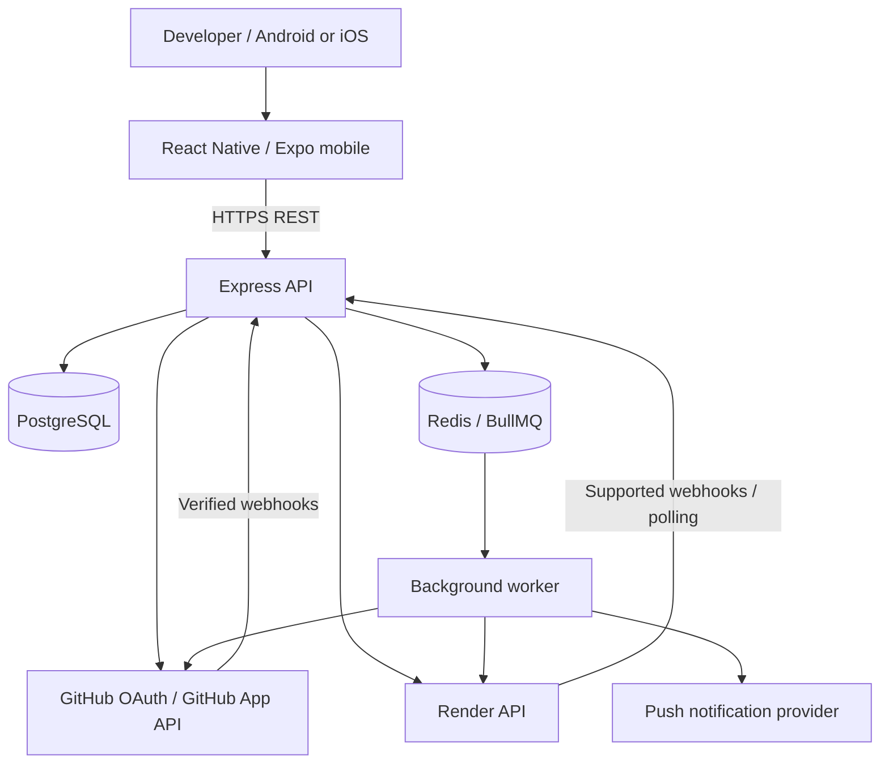
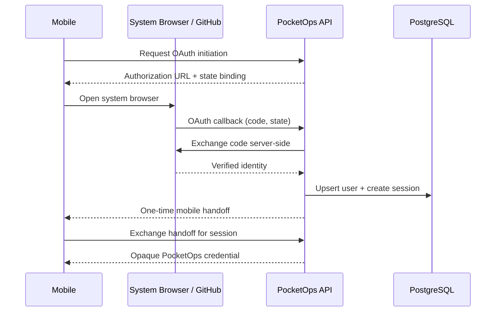
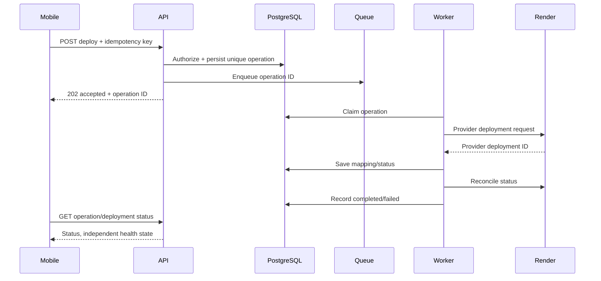

# PocketOps — Technical Architecture

**Version:** 1.4 | **Status:** Target architecture with identity/session, repository explorer, guarded source editor and Render deployment operations implemented

## 1. Architectural decisions

PocketOps uses a **single npm-workspaces monorepo** with a **native React Native/Expo application**, a **modular-monolith Express API**, **PostgreSQL/Sequelize** for persistent state, **Redis/BullMQ** for background jobs and external adapters for **GitHub and Render**. Native navigation/dashboards/notifications/deployment operations are mandatory. Only source editing uses a packaged **CodeMirror 6 WebView**. A cloud terminal and arbitrary repository execution are **excluded** from the MVP.

### System context



## 2. Runtime boundaries

**Mobile:** screens, secure PocketOps credential storage, navigation, encrypted local editor drafts and user confirmations. Never receives GitHub installation tokens, Render credentials or backend encryption keys.

**API:** identity, resource-level authorization, request validation, GitHub/Render orchestration, audit persistence, webhook verification and job scheduling. Provider responses must be normalized and sanitized.

**Worker:** retryable and scheduled work, reconciliation, notifications, health verification. The deployment worker is a separate process entrypoint (`server/src/jobs/deployment-worker.js`, `npm run worker:deployments`) with constrained provider credentials; GitHub webhook processing currently runs in the API process. Do not assume worker tasks are exactly-once: design for at-least-once delivery, and never re-dispatch a deployment request whose provider outcome is ambiguous.

**PostgreSQL:** source of truth for users, sessions, OAuth transactions, authentication audit events, GitHub App installation links/memberships, repository catalog/selections and webhook deliveries, plus Render provider connections, projects, deployment records and durable deployment operation requests. Incident and notification state remain planned.

**Redis:** queue transport and transient coordination, not authoritative record of production operations. Durable operation state lives in PostgreSQL.

## 3. Mobile architecture

### Recommended stack

- React Native + Expo, JavaScript/JSX, Expo Router, NativeWind/Tailwind-compatible configuration.
- TanStack Query for API caching/revalidation; Zustand only for small client-only UI state.
- Expo AuthSession / system browser for OAuth; Expo SecureStore for opaque PocketOps session tokens.
- Expo Notifications for native push, with in-app fallback and token registration.
- CodeMirror 6 packaged into an isolated React Native WebView for editor only.

### Suggested mobile feature modules

```text
mobile/
  app/(auth)/login.jsx
  app/(tabs)/{index,repositories,deployments,incidents,settings}.jsx
  app/repository/[id].jsx
  app/editor/[id].jsx
  app/project/[id].jsx
  src/features/{auth,repositories,editor,deployments,incidents,notifications}/
  src/components/{ui,feedback,layout}/
  src/services/{api,session,deepLinks}/
  src/store/
  src/theme/
```

**Note:** these are target folders; the starter has only the foundational subset.

### Editor message bridge

Protocol v1 allowlists `EDITOR_READY`, `LOAD_DOCUMENT`, `DOCUMENT_READY`, `DOCUMENT_CHANGED`, `CURSOR_CHANGED`, `REQUEST_CONTENT`, `CONTENT_RESULT`, `SET_READ_ONLY` and `EDITOR_ERROR`. Each message carries version, session ID, request ID and strict validated fields; enforce bounded message/content size and correlation. The native host owns authoritative branch/file SHA and commit operation. The editor must not make authenticated provider requests. Disable arbitrary navigation, file access and uncontrolled JavaScript injection.

## 4. Backend modules and responsibilities

```text
server/src/
  modules/auth/          OAuth callbacks, sessions, current user
  modules/github/        installation registration and permissions
  modules/repositories/  tree/file/branch reads
  modules/editor/        commit orchestration and conflict checks
  modules/projects/      repository-to-service mapping
  modules/deployments/   deployment operations and status
  modules/incidents/     incident lifecycle and timeline
  modules/notifications/ push tokens and preferences
  modules/audit/         security and activity records
  integrations/github/   Octokit adapter
  integrations/render/   provider adapter
  jobs/{queues,processors,scheduler}/
  db/{models,migrations}/
  middleware/{auth,authorize,validate,errors,rateLimit}/
```

**Controller:** parse validated input and return HTTP response. **Service:** business logic, authorization orchestration and transactions. **Repository:** database queries. **Adapter:** upstream API contract, timeouts, retries, normalization. **Worker:** background job coordination. Do not call provider APIs directly from controllers.

## 5. Authentication and authorization sequence



The implemented identity flow creates a hashed state transaction through a mobile-start request, uses the system browser, exchanges the code on the backend, and binds the one-use handoff to an in-memory mobile completion secret. OAuth transactions and handoffs expire and are consumed once. GitHub's published OAuth App authorization parameters do not document PKCE, so the current confidential backend client uses state and the completion-secret binding rather than unsupported PKCE parameters. Identity sign-in grants no GitHub App installation or repository permissions.

The separate GitHub App flow uses its own hashed OAuth/setup state and native system-browser callback. The backend verifies the GitHub identity against the signed-in PocketOps user, encrypts expiring GitHub user/refresh tokens, maps installation access per PocketOps user and revalidates upstream access before each repository read or write. GitHub webhooks are raw-body HMAC verified and deduplicated into a durable PostgreSQL queue. Mobile screens provide a native repository explorer and use a bundled CodeMirror WebView only for source editing; branch selection, diff, confirmation, commit and PR screens remain native. Durable operation/idempotency rows and audit events track mutations without storing source content. See [Repository explorer](REPOSITORY_EXPLORER.md) and [Code editor](CODE_EDITOR.md).

## 6. Repository edit sequence

1. GET file content, ref and blob SHA from GitHub adapter.
2. Create fix branch from selected base commit SHA.
3. Open file in CodeMirror WebView and retain local draft.
4. Show native diff review and commit confirmation.
5. Server validates path/branch/size and current authorization.
6. Server commits with expected SHA; on conflict return 409 and no write.
7. Optionally open PR; respect branch protections and checks.

For multi-file atomic edits, introduce Git tree/commit operations in a later iteration; do not imply the single-file endpoint is atomic across files.

## 7. Deployment and incident flow



Idempotency must survive worker retries and server restarts. If a provider request times out after an unknown outcome, reconcile by provider state before attempting another mutation. No automatic retry of ambiguous production writes.

## 8. Deployment provider abstraction

```js
class DeploymentProvider {
  async listServices(connection, options) {}
  async listDeployments(connection, serviceId, options) {}
  async getLogs(connection, serviceId, options) {}
  async requestDeployment(connection, serviceId, action, options) {}
  async getDeployment(connection, deploymentId) {}
}
```

Providers differ in rollback, redeploy, logs and API semantics. Model capabilities explicitly (`canRedeploy`, `canRollback`, `supportsLogs`) rather than assuming universal support. Do not send provider credentials to the client.

## 9. Error handling, state and observability

Normalize errors to `{success:false,error:{code,message},meta:{requestId}}`; map permission failures to 403, stale revisions to 409, validation to 422, upstream failures to 502/503 and throttling to 429. Log correlation/request IDs, provider latency, webhook processing outcomes, queue depth and health verification. Mask sensitive fields and log snippets. UI uses TanStack Query to refresh status, not optimistic claims of production success.

## 10. Scaling and deployment

Initial hosting: mobile built with Expo/EAS; Express on a managed web service; PostgreSQL managed database; managed Redis; separate worker. Keep migrations explicit, versioned and deploy-safe. Use CI for lint, tests, migrations and mobile configuration validation. The foundation implements `/health` as database-independent liveness and `/ready` as a bounded PostgreSQL readiness check. Redis/BullMQ is not configured or required until worker functionality is introduced.

## 11. Future cloud IDE extension (not MVP)

Add Workspace Orchestrator, isolated ephemeral containers/VMs, filesystem and terminal gateway, resource quotas, network egress restrictions, per-session credentials, expiration and teardown. Run this infrastructure separately from API and worker; never expose Docker host sockets or production secrets. Future extension must not require replacing the repository, project or incident domain models.

## 12. Architectural decisions to revisit

- Session implementation: opaque mobile bearer credential with hashed server-side session record recommended; no GitHub token on device.
- Push notifications: Expo push vs direct FCM/APNs; verify platform requirements.
- Render webhook availability and fallback polling strategy.
- CodeMirror asset packaging and bridge versioning.
- Team ownership/authorization schema before multi-user release.

See [PRD](PRD.md), [Security](SECURITY.md), [Database](DATABASE.md), [API](API.md).
