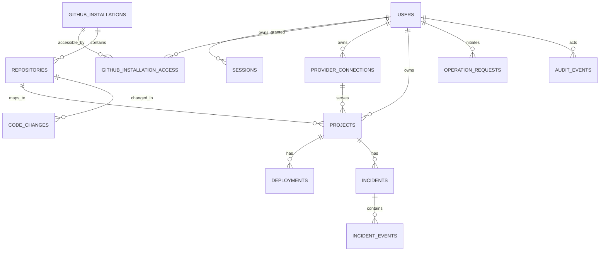

# PocketOps — Database Design and Migration Specification

**Version:** 1.1 | **Engine:** PostgreSQL 16+ | **ORM:** Sequelize | **Status:** Target schema, not automatically migrated by scaffold

## 1. Design principles

Use UUID primary keys for PocketOps entities, provider-native identifiers as unique external keys, `TIMESTAMPTZ` for all event timestamps, `JSONB` only for flexible non-secret metadata, explicit foreign keys, unique constraints and migrations. Never use `sequelize.sync({alter:true})` in deployed environments. Sensitive provider credentials are encrypted before persistence. Do not persist source files or full raw logs as ordinary relational records.

## 2. Relationships



## 3. Tables and columns

| Table                        | Core fields                                                                                                                 | Constraints and purpose                                                             |
| ---------------------------- | --------------------------------------------------------------------------------------------------------------------------- | ----------------------------------------------------------------------------------- |
| `users`                      | id UUID, github_user_id BIGINT, username, email nullable, avatar_url, timestamps                                            | UNIQUE github_user_id; email not authoritative                                      |
| `sessions`                   | id UUID, user_id, token_hash, device_label, expires_at, revoked_at, last_used_at                                            | UNIQUE token_hash; indexed user/expiry; never store raw session token               |
| `oauth_states`               | id, state_hash, verifier_ciphertext, redirect_uri, expires_at, consumed_at                                                  | One-time PKCE/state flow; short TTL                                                 |
| `github_installations`       | id, installation_id BIGINT, account_login, account_type, suspended_at, timestamps                                           | UNIQUE installation_id; account may be organization                                 |
| `github_installation_access` | id, installation_id FK, user_id FK, last_verified_at, status                                                                | UNIQUE(installation_id,user_id); verify GitHub access live for sensitive operations |
| `repositories`               | id, installation_id FK, github_repo_id BIGINT, owner, name, full_name, default_branch, is_private, is_active                | UNIQUE github_repo_id; soft-disable on removal                                      |
| `provider_connections`       | id, user_id FK, provider, display_name, encrypted_credentials, key_version, status, revoked_at                              | Never return ciphertext to mobile                                                   |
| `projects`                   | id, user_id FK, repository_id FK, connection_id FK, provider_service_id, name, production_url, health_check_path            | UNIQUE(connection_id,provider_service_id); validate owner matches connection        |
| `code_changes`               | id, user_id FK, repository_id FK, branch_name, base_commit_sha, commit_sha, pr_number, status                               | Audit-friendly metadata, no full file bodies                                        |
| `deployments`                | id, project_id FK, provider_deployment_id, commit_sha, status, triggered_by nullable, started_at, finished_at               | UNIQUE(project_id,provider_deployment_id)                                           |
| `incidents`                  | id, project_id FK, deployment_id nullable FK, title, description, severity, status, detected_at, resolved_at                | Severity/status check constraints                                                   |
| `incident_events`            | id, incident_id FK, actor_id nullable FK, event_type, details JSONB, created_at                                             | Append-only timeline, redact sensitive content                                      |
| `operation_requests`         | id, actor_id FK, project_id FK, action, idempotency_key, request_hash, status, provider_reference, result JSONB, timestamps | UNIQUE(actor_id,idempotency_key); reject same key with different request hash       |
| `webhook_deliveries`         | id, provider, delivery_id, event_type, received_at, processed_at, status, attempt_count                                     | UNIQUE(provider,delivery_id)                                                        |
| `audit_events`               | id, actor_id nullable FK, action, resource_type, resource_id, metadata JSONB, request_id, created_at                        | Append-only, no credentials                                                         |
| `push_devices`               | id, user_id FK, device_token_ciphertext, platform, enabled, last_seen_at                                                    | Device token revocation and rotation                                                |
| `notification_preferences`   | user_id FK, deployment_failed, incident_updates, quiet_hours nullable                                                       | Explicit opt-in policy as required                                                  |
| `health_checks`              | id, project_id FK, last_status, checked_at, response_ms, error_code                                                         | No arbitrary user-provided targets                                                  |

## 4. Suggested SQL migration excerpt

```sql
CREATE EXTENSION IF NOT EXISTS pgcrypto;
CREATE TABLE users (
  id UUID PRIMARY KEY DEFAULT gen_random_uuid(),
  github_user_id BIGINT NOT NULL UNIQUE,
  username VARCHAR(100) NOT NULL,
  email VARCHAR(255),
  avatar_url TEXT,
  created_at TIMESTAMPTZ NOT NULL DEFAULT NOW(),
  updated_at TIMESTAMPTZ NOT NULL DEFAULT NOW()
);
CREATE TABLE sessions (
  id UUID PRIMARY KEY DEFAULT gen_random_uuid(),
  user_id UUID NOT NULL REFERENCES users(id) ON DELETE CASCADE,
  token_hash CHAR(64) NOT NULL UNIQUE,
  expires_at TIMESTAMPTZ NOT NULL,
  revoked_at TIMESTAMPTZ,
  last_used_at TIMESTAMPTZ,
  created_at TIMESTAMPTZ NOT NULL DEFAULT NOW()
);
CREATE INDEX idx_sessions_user_expiry ON sessions(user_id, expires_at);
CREATE TABLE github_installations (
  id UUID PRIMARY KEY DEFAULT gen_random_uuid(),
  installation_id BIGINT NOT NULL UNIQUE,
  account_login VARCHAR(255) NOT NULL,
  account_type VARCHAR(30) NOT NULL,
  suspended_at TIMESTAMPTZ,
  created_at TIMESTAMPTZ NOT NULL DEFAULT NOW()
);
CREATE TABLE github_installation_access (
  id UUID PRIMARY KEY DEFAULT gen_random_uuid(),
  installation_id UUID NOT NULL REFERENCES github_installations(id),
  user_id UUID NOT NULL REFERENCES users(id),
  status VARCHAR(20) NOT NULL DEFAULT 'active',
  last_verified_at TIMESTAMPTZ,
  UNIQUE(installation_id, user_id)
);
```

**Important:** the migration excerpt is illustrative, not the complete database migration set. Codex must implement all target tables in incremental migrations and test upgrades/rollbacks.

## 5. Index plan

- `repositories(installation_id, is_active)` and `repositories(github_repo_id)` unique.
- `projects(user_id, created_at DESC)` and unique `(connection_id, provider_service_id)`.
- `deployments(project_id, created_at DESC)` and unique `(project_id, provider_deployment_id)`.
- `incidents(project_id, status, detected_at DESC)`.
- `incident_events(incident_id, created_at ASC)`.
- `audit_events(actor_id, created_at DESC)`; `audit_events(resource_type, resource_id, created_at DESC)`.
- `webhook_deliveries(provider, delivery_id)` unique.
- `operation_requests(actor_id, idempotency_key)` unique; optionally `(project_id, created_at DESC)`.

## 6. State machines

**Operation:** `queued → processing → succeeded|failed|unknown`, with `unknown → reconciled` or manual intervention. **Deployment:** `pending → building → deploying → live|failed|canceled` (normalize provider states without inventing missing stages). **Incident:** `open → investigating → mitigated → resolved`, with reopen allowed and logged. Enforce transitions in services, not only UI.

## 7. Data consistency

Wrap DB-local mutations and audit writes in transactions. Provider APIs cannot join SQL transactions; use an operation row and outbox/queue pattern. Unique idempotency key plus request hash prevents duplicate effects. On ambiguous upstream timeouts, reconcile before retry. Soft-disable removed GitHub repositories; revoke access immediately. Keep user-to-installation access separate from installation owner metadata.

## 8. Retention and privacy (proposed defaults)

- OAuth states: purge after expiry (minutes).
- Sessions: purge expired/revoked records on a schedule, preserving minimal security audit.
- Webhook payloads: avoid storing raw sensitive bodies; retain IDs and processing metadata for deduplication.
- Logs: stream/bound; do not store raw production logs by default.
- Audit events: define a documented retention period before production; immutable except legal/privacy deletion obligations.
- Local drafts: encrypted/OS-protected storage where feasible; user-controlled discard and retention.

## 9. Migration order

1. Users, OAuth state and sessions.
2. GitHub installations, access and repositories.
3. Provider connections and projects.
4. Code changes and deployments.
5. Operation requests, webhook deliveries and audit events.
6. Incidents, incident events and health checks.
7. Push devices and notification preferences.

For each migration: up/down tests on disposable PostgreSQL, unique/FK checks, data backfill strategy and deployment order. No destructive migration without backup and rollback plan.

## 10. Query-level authorization examples

`GET /projects/:id`: constrain by authenticated user and connection ownership, then verify external provider access when needed. `GET /repositories/:id/file`: ensure repository is within active installation and current user has permission; never authorize solely by a guessed UUID. `POST /deployments`: validate ownership, connection status, operation policy and exact provider service mapping.

See [Security](SECURITY.md), [API](API.md), [Architecture](ARCHITECTURE.md).
