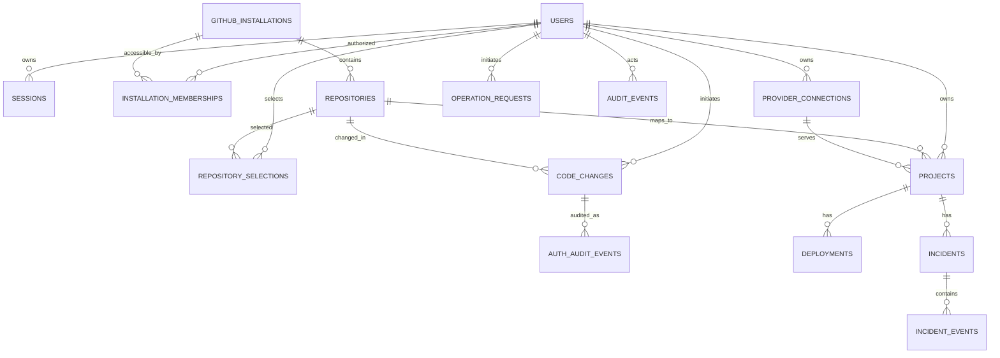

# PocketOps — Database Design and Migration Specification

**Version:** 1.4 | **Engine:** PostgreSQL 16+ | **ORM:** Sequelize | **Status:** migrations create GitHub App integration, durable editor operation state and Render deployment state

The foundation migrations `001-create-users.js` and `002-create-sessions.js` provide user/session storage. Migration `003-create-auth-workflows.js` adds state-bound identity OAuth transactions and authentication audit events. Migration `004-create-github-integration.js` adds GitHub App installation state, user memberships, repository catalog/selections and durable webhook deliveries. Migration `005-create-code-changes.js` adds idempotent editor operation records and optional audit linkage. Migration `006-create-deployments.js` adds provider connections, projects, deployments and operation requests, plus audit linkage to operation requests.

## 1. Design principles

Use UUID primary keys for PocketOps entities, provider-native identifiers as unique external keys, `TIMESTAMPTZ` for all event timestamps, `JSONB` only for flexible non-secret metadata, explicit foreign keys, unique constraints and migrations. Never use `sequelize.sync({alter:true})` in deployed environments. Sensitive provider credentials are encrypted before persistence. Do not persist source files or full raw logs as ordinary relational records.

## 2. Relationships



## 3. Tables and columns

| Table                       | Core fields                                                                                                                 | Constraints and purpose                                                         |
| --------------------------- | --------------------------------------------------------------------------------------------------------------------------- | ------------------------------------------------------------------------------- |
| `users`                     | id UUID, github_user_id BIGINT, username, email nullable, avatar_url, timestamps                                            | UNIQUE github_user_id; email not authoritative                                  |
| `sessions`                  | id UUID, user_id, token_hash, device_label, expires_at, revoked_at, last_used_at                                            | UNIQUE token_hash; indexed user/expiry; never store raw session token           |
| `oauth_transactions`        | id, state_hash, completion_secret_hash, user_id nullable, redirect_uri, expiry/consumption timestamps, handoff_hash         | One-time state/handoff; hashes only; exact allowlisted redirect; short TTL      |
| `auth_audit_events`         | id, actor_user_id nullable, action, request_id, metadata JSONB, created_at                                                  | Append-only authentication events; never credentials                            |
| `github_installation_links` | state_hash, install_state_hash, user_id, GitHub user ID, encrypted user/refresh token, expiry and consumed timestamps       | Unique hashed state values; 15-minute lifetime; ciphertext only                 |
| `github_installations`      | id, github_installation_id BIGINT, account ID/login/type, permissions, suspended/removed timestamps                         | UNIQUE provider installation ID; installation owner is independent of installer |
| `installation_memberships`  | installation_id FK, user_id FK, GitHub user ID, encrypted user/refresh tokens, expiries, status                             | UNIQUE(installation_id,user_id); current provider access rechecked before reads |
| `repositories`              | id, installation_id FK, github_repository_id BIGINT, owner/name/full_name, default_branch, privacy/archive/removal state    | UNIQUE provider repository ID; shared catalog is not an authorization grant     |
| `repository_selections`     | user_id FK, repository_id FK, selected_at                                                                                   | UNIQUE(repository_id,user_id); explicit per-user access selection               |
| `provider_connections`      | id, user_id FK, provider, display_name, encrypted_credentials, key_version, status, revoked_at                              | UNIQUE(user_id,id); CHECK status active\|revoked; never return ciphertext to mobile                                       |
| `projects`                  | id, user_id FK, repository_id FK, connection_id FK, provider_service_id, name, status                                       | UNIQUE(connection_id,provider_service_id) and UNIQUE(user_id,provider_service_id); composite FK (user_id,connection_id); validate owner matches connection |
| `code_changes`              | id, actor_user_id FK, repository_id FK, operation_type, idempotency_key/fingerprint, status, branch/base/file/SHA/PR metadata, request_id | UNIQUE(actor_user_id,idempotency_key); operation/status checks; never stores source text or credentials |
| `deployments`               | id, project_id FK, provider_deployment_id, status, provider_status, commit_sha, health_status default not_checked, started_at, finished_at | UNIQUE(project_id,provider_deployment_id); health_status is always not_checked until health verification ships |
| `incidents`                 | id, project_id FK, deployment_id nullable FK, title, description, severity, status, detected_at, resolved_at                | Severity/status check constraints                                               |
| `incident_events`           | id, incident_id FK, actor_id nullable FK, event_type, details JSONB, created_at                                             | Append-only timeline, redact sensitive content                                  |
| `operation_requests`        | id, actor_id FK, project_id FK, action, idempotency_key, request_hash, target_deployment_id, commit_sha, status, provider_reference, deployment_id, error_code, request_id, attempts, next_attempt_at, claim_token, claim_expires_at | UNIQUE(actor_id,idempotency_key); CHECK status queued/validating/requesting/accepted/succeeded/failed/unknown; partial unique one active op per project; claim lease for the worker |
| `webhook_deliveries`        | id, delivery_id, event_type, normalized payload, received/processed times, status, attempts, retry/claim metadata           | UNIQUE delivery ID; no raw webhook body; durable PostgreSQL processing queue    |
| `audit_events`              | id, actor_id nullable FK, action, resource_type, resource_id, metadata JSONB, request_id, created_at                        | Append-only, no credentials                                                     |
| `push_devices`              | id, user_id FK, device_token_ciphertext, platform, enabled, last_seen_at                                                    | Device token revocation and rotation                                            |
| `notification_preferences`  | user_id FK, deployment_failed, incident_updates, quiet_hours nullable                                                       | Explicit opt-in policy as required                                              |
| `health_checks`             | id, project_id FK, last_status, checked_at, response_ms, error_code                                                         | No arbitrary user-provided targets                                              |

## 4. Foundation schema and migration tooling

The users migration creates UUID primary keys, a unique `github_user_id`, username, optional email/avatar, and timestamp columns. The sessions migration references users with cascade deletion and stores only a unique 64-character `token_hash`, optional device label, expiry, revocation/use timestamps, and creation time. It adds an index on `(user_id, expires_at)`.

Migration `003-create-auth-workflows.js` creates `oauth_transactions` with unique SHA-256 hashes for state and handoff, a completion-secret hash, an allowlisted redirect URI, expiry timestamps and consumed timestamps. Its foreign key ties a verified identity to the transaction; the transaction is not a GitHub permission grant. `auth_audit_events` records callback acceptance, identity verification, session creation/rotation/revocation and safe provider-failure categories without codes or tokens. Indexes support transaction expiry and user/action audit history.

Session credentials are 256-bit opaque random values. Only SHA-256 hashes are stored in `sessions.token_hash`. A 30-day session lifetime is enforced at query time; a six-hour cleanup task removes OAuth transactions older than 24 hours and expired/revoked sessions older than 30 days. Cleanup does not delete authentication audit records. Rotation accepts a new 256-bit token generated and persisted in Expo SecureStore by the client, then atomically revokes the prior session and stores the new hash.

Use `npm run db:migrate` to apply pending migrations, `npm run db:migrate:undo` to reverse the latest one, and `npm run db:migrate:undo:all` only against a disposable database. Migration `005-create-code-changes.js` is reversible and drops editor operation records/audit linkage on rollback; assess pending operations before rolling back. The runner records applied filenames in `SequelizeMeta` and runs each migration in a transaction. Production rollback is intentionally disabled by the CLI.

## 5. Suggested SQL migration excerpt

```sql
CREATE EXTENSION IF NOT EXISTS pgcrypto;
CREATE TABLE users (
  id UUID PRIMARY KEY DEFAULT gen_random_uuid(),
  github_user_id BIGINT NOT NULL UNIQUE,
  username VARCHAR(100) NOT NULL,
  email VARCHAR(255),
  avatar_url TEXT,
  created_at TIMESTAMPTZ NOT NULL DEFAULT NOW(),
  updated_at TIMESTAMPTZ NOT NULL DEFAULT NOW()
);
CREATE TABLE sessions (
  id UUID PRIMARY KEY DEFAULT gen_random_uuid(),
  user_id UUID NOT NULL REFERENCES users(id) ON DELETE CASCADE,
  token_hash CHAR(64) NOT NULL UNIQUE,
  expires_at TIMESTAMPTZ NOT NULL,
  revoked_at TIMESTAMPTZ,
  last_used_at TIMESTAMPTZ,
  created_at TIMESTAMPTZ NOT NULL DEFAULT NOW()
);
CREATE INDEX idx_sessions_user_expiry ON sessions(user_id, expires_at);
CREATE TABLE github_installations (
  id UUID PRIMARY KEY DEFAULT gen_random_uuid(),
  github_installation_id BIGINT NOT NULL UNIQUE,
  github_account_id BIGINT NOT NULL,
  account_login VARCHAR(255) NOT NULL,
  account_type VARCHAR(30) NOT NULL,
  repository_selection VARCHAR(20) NOT NULL,
  permissions JSONB NOT NULL DEFAULT '{}',
  suspended_at TIMESTAMPTZ,
  removed_at TIMESTAMPTZ,
  created_at TIMESTAMPTZ NOT NULL DEFAULT NOW()
);
CREATE TABLE installation_memberships (
  id UUID PRIMARY KEY DEFAULT gen_random_uuid(),
  installation_id UUID NOT NULL REFERENCES github_installations(id),
  user_id UUID NOT NULL REFERENCES users(id),
  github_user_id BIGINT NOT NULL,
  github_user_token_encrypted TEXT NOT NULL,
  github_refresh_token_encrypted TEXT NOT NULL,
  status VARCHAR(20) NOT NULL DEFAULT 'active',
  last_verified_at TIMESTAMPTZ,
  UNIQUE(installation_id, user_id)
);
CREATE TABLE repositories (
  id UUID PRIMARY KEY DEFAULT gen_random_uuid(),
  installation_id UUID NOT NULL REFERENCES github_installations(id),
  github_repository_id BIGINT NOT NULL UNIQUE,
  owner_login VARCHAR(255) NOT NULL,
  owner_github_id BIGINT NOT NULL,
  name VARCHAR(255) NOT NULL,
  full_name VARCHAR(511) NOT NULL,
  default_branch VARCHAR(255),
  is_private BOOLEAN NOT NULL,
  is_archived BOOLEAN NOT NULL DEFAULT FALSE,
  removed_at TIMESTAMPTZ
);
CREATE TABLE repository_selections (
  repository_id UUID NOT NULL REFERENCES repositories(id),
  user_id UUID NOT NULL REFERENCES users(id),
  selected_at TIMESTAMPTZ NOT NULL DEFAULT NOW(),
  UNIQUE(repository_id, user_id)
);
```

**Important:** the excerpt is illustrative. The authoritative implementation is the versioned migration set, including `004-create-github-integration.js`, `005-create-code-changes.js` and `006-create-deployments.js`.

## 6. Index plan

- `repositories(installation_id, removed_at)` and `repositories(github_repository_id)` unique.
- `installation_memberships(user_id, status)` and unique `(installation_id, user_id)`.
- `repository_selections(user_id, selected_at)` and unique `(repository_id, user_id)`.
- `projects(user_id, created_at DESC)` and unique `(connection_id, provider_service_id)`.
- `deployments(project_id, created_at DESC)` and unique `(project_id, provider_deployment_id)`.
- `incidents(project_id, status, detected_at DESC)`.
- `incident_events(incident_id, created_at ASC)`.
- `audit_events(actor_id, created_at DESC)`; `audit_events(resource_type, resource_id, created_at DESC)`.
- `webhook_deliveries(delivery_id)` unique; delivery rows retain normalized payloads, retry count and claim state.
- `operation_requests(actor_id, idempotency_key)` unique; optionally `(project_id, created_at DESC)`.

## 7. State machines

**Operation:** `queued → validating → requesting → accepted → succeeded|failed|unknown`, claimed with a `FOR UPDATE SKIP LOCKED` lease by the deployment worker; stale `requesting` claims become `unknown` and are never re-dispatched automatically. **Deployment:** normalized provider states `queued|building|live|failed|canceled|unknown` (no invented stages; unmapped provider values become `unknown` while the raw provider status is preserved). Health status is a separate column that remains `not_checked` until health verification ships. **Incident:** `open → investigating → mitigated → resolved`, with reopen allowed and logged. Enforce transitions in services, not only UI.

## 8. Data consistency

Wrap DB-local mutations and audit writes in transactions. Provider APIs cannot join SQL transactions; use an operation row and outbox/queue pattern. Unique idempotency key plus request hash prevents duplicate effects. On ambiguous upstream timeouts, reconcile before retry. Soft-disable removed GitHub repositories; revoke access immediately. Keep user-to-installation access separate from installation owner metadata.

## 9. Retention and privacy (proposed defaults)

- OAuth states: purge after expiry (minutes).
- Sessions: purge expired/revoked records on a schedule, preserving minimal security audit.
- Webhook payloads: avoid storing raw sensitive bodies; retain IDs and processing metadata for deduplication.
- Logs: stream/bound; do not store raw production logs by default.
- Audit events: define a documented retention period before production; immutable except legal/privacy deletion obligations.
- Local drafts: encrypted/OS-protected storage where feasible; user-controlled discard and retention.

## 10. Migration order

1. Users and sessions (`001`, `002`).
2. Identity OAuth transactions and authentication audit events (`003`).
3. GitHub App links, installations, memberships, repositories, per-user selections and webhook deliveries (`004`).
4. Durable editor operations and audit linkage (`005`).
5. Provider connections, projects, deployments and operation requests (`006`).
6. Incidents, incident events and health checks (planned).
7. Push devices and notification preferences (planned).

For each migration: up/down tests on disposable PostgreSQL, unique/FK checks, data backfill strategy and deployment order. No destructive migration without backup and rollback plan.

## 11. Query-level authorization examples

`GET /projects/:id`: constrain by authenticated user and connection ownership, then verify external provider access when needed. `GET /github/repositories/:id/file`: require an explicit user selection, active user-to-installation membership, current GitHub user and App installation visibility, and current repository membership; never authorize solely by a guessed UUID. `POST /deployments`: validate ownership, connection status, operation policy and exact provider service mapping.

See [Security](SECURITY.md), [API](API.md), [Architecture](ARCHITECTURE.md).
